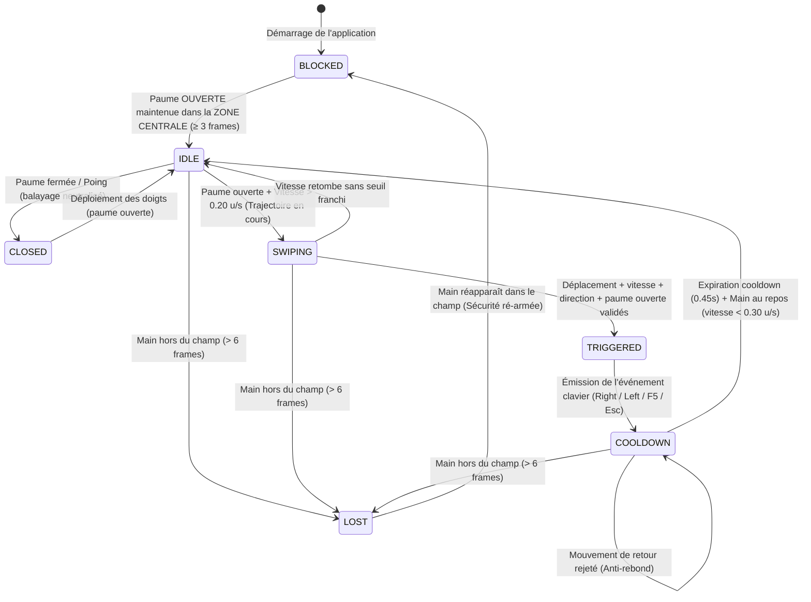

# Spécification des Règles de Transition et Gestes Dynamiques — Hand Control (Présentation)

Ce document détaille l'ensemble des règles temporelles, de la machine à états et des mécanismes anti-rebond implémentés dans le moteur dynamique ([temporal_engine.py](file:///c:/Users/LOU/Documents/CDAR/Hand/App_P/gestures/temporal_engine.py)) pour le cas d'usage **Présentation de document**.

---

## 1. Machine à états dynamique (FSM)

Les balayages dynamiques intègrent un verrou d'entrée/sortie de champ (`BLOCKED`) et exigent la **paume ouverte** comme précondition d'exécution :

---

## 2. Règle de Sécurité Entrée/Sortie : Verrou Central (`BLOCKED`)

Afin d'éviter tout déclenchement intempestif lorsque l'orateur amène sa main dans le champ de la caméra ou l'en retire :

1. **Verrouillage automatique (`BLOCKED`)** :
   * Au lancement ou dès que la main sort du champ de vision (perte de tracking > 6 frames), le système bascule immédiatement en état **`BLOCKED`**.
   * Lorsque la main réentre dans le champ, la détection reste **totalement bloquée**. Tout mouvement ou geste est ignoré.
2. **Déverrouillage par Présentation Centrale & Armement au repos** :
   * Pour déverrouiller la détection (`BLOCKED` $\rightarrow$ `IDLE`), l'utilisateur doit positionner sa main dans la **zone de visée** élargie :
     $$\text{Cadre de visée} : x \in [0.20, 0.80], \quad y \in [0.15, 0.85]$$
   * La main doit y présenter une **paume ouverte** pendant au moins **2 images** ($\approx 66\text{ ms}$).
   * **Armement au repos (Anti-faux F5)** : Lors de la montée du bras vers le centre, le système reste désarmé tant que la vitesse ne retombe pas sous le seuil de repos ($< 0.30\text{ u/s}$). Cela empêche catégoriquement le geste de levée du bras d'être confondu avec un `SWIPE_UP` (F5).
   * Une fois stabilisée, la main est **armée** et l'utilisateur peut balayer librement dans tout l'écran vers la droite, la gauche, le haut ou le bas.

---

## 3. Catalogue des gestes dynamiques et actions de présentation

| Geste Dynamique | Condition morphologique | Mouvement physique | Touche clavier | Action de présentation |
|---|---|---|:---:|---|
| **`SWIPE_RIGHT`** | **Paume ouverte** | Balayage horizontal vers la droite ($\Delta x > +0.08$, $\|\Delta x\| \ge 1.15 \|\Delta y\|$) | **`Right`** (ou `PageDown`) | **Diapositive Suivante** / Page suivante (avancer) |
| **`SWIPE_LEFT`** | **Paume ouverte** | Balayage horizontal vers la gauche ($\Delta x < -0.08$, $\|\Delta x\| \ge 1.15 \|\Delta y\|$) | **`Left`** (ou `PageUp`) | **Diapositive Précédente** / Page précédente (reculer) |
| **`SWIPE_UP`** | **Paume ouverte** | Balayage vertical vers le haut ($\Delta y < -0.08$, $\|\Delta y\| \ge 1.15 \|\Delta x\|$) | **`F5`** | **Lancer Diaporama** / Plein écran |
| **`SWIPE_DOWN`** | **Paume ouverte** | Balayage vertical vers le bas ($\Delta y > +0.08$, $\|\Delta y\| \ge 1.15 \|\Delta x\|$) | **`Escape`** | **Quitter Diaporama** / Sortie plein écran |

---

## 4. Précondition stricte : Détection de la Paume Ouverte

Pour éliminer les faux positifs lorsque l'orateur bouge le bras sans vouloir changer de diapositive (boire un verre d'eau, tenir un stylo, serrer le poing, geste de repos), le système impose un verrou morphologique :

1. **Critère d'ouverture (`LandmarkProcessor._evaluate_openness`)** :
   * L'extension continue des doigts principaux (`index`, `middle`, `ring`, `pinky`) est calculée.
   * La paume est classée **OUVERTE** si et seulement si :
     - Au moins **3 doigts** parmi les 4 sont nettement étendus ($\text{score} \ge 0.48$).
     - La moyenne d'ouverture globale est $\ge 0.48$.
2. **Rejet des postures fermées** :
   * Poing fermé (`FIST`) $\rightarrow$ **Balayage bloqué**.
   * Pointage à un doigt (`INDEX_POINT`) $\rightarrow$ **Balayage bloqué**.
   * Main tenant un objet ou doigts recroquevillés $\rightarrow$ **Balayage bloqué**.
3. **Persistance sur la trajectoire** :
   * La paume doit être ouverte sur au moins $60\,\%$ de la durée du balayage et **strictement ouverte au point d'impact final** du geste.

---

## 5. Paramètres cinématiques de détection (`GestureClassifier`)

1. **Déplacement net minimal (`min_displacement = 0.08`)** :
   $$\text{distance} = \sqrt{\Delta x^2 + \Delta y^2} \ge 0.08$$
   Élimine les micro-tremblements.

2. **Vitesse minimale (`min_velocity = 0.28` unités/s)** :
   $$v = \frac{\text{distance}}{\Delta t} \ge 0.28$$
   Distingue un balayage vif d'un lent repositionnement de la main.

3. **Dominance directionnelle orthogonale (`directional_ratio = 1.25`)** :
   - Horizontal : $\frac{|\Delta x|}{|\Delta y|} \ge 1.25$
   - Vertical : $\frac{|\Delta y|}{|\Delta x|} \ge 1.25$
   Rejette les diagonales imprécises.

4. **Linéarité de trajectoire (`min_efficiency = 0.55`)** :
   $$\text{Efficacité} = \frac{\text{Distance nette}}{\text{Longueur cumulée du chemin}} \ge 0.55$$

---

## 6. Sécurité Anti-Rebond : Rejet du mouvement de retour

1. **Période réfractaire de Cooldown (`cooldown_duration = 0.45 s`)** :
   - Dès la validation d'un geste, le buffer de trajectoire est vidé.
   - Aucun nouveau geste ne peut être émis pendant 0.45 s.
2. **Réarmement conditionnel par retour au repos (`rest_speed_threshold = 0.30 u/s`)** :
   - Après le cooldown, le système attend que la main ralentisse avant de réarmer la détection.
